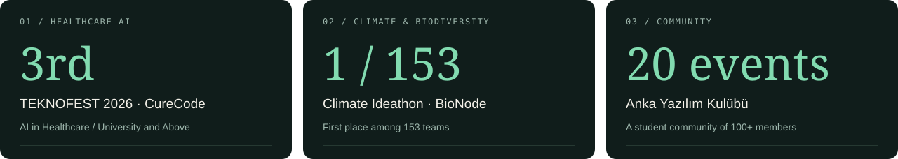

  <a href="https://chartezian.com">Building Chartezian</a> ·
  <a href="https://www.linkedin.com/in/furkanaksoy-dev/">LinkedIn</a> ·
  <a href="mailto:furkanaksoy178@gmail.com">Email</a>

I'm a Software Engineering graduate from Maltepe University, based in Istanbul. I work on AI applications, Text-to-SQL, and backend systems, mostly with Python, Java, Spring Boot, and React.

I'm especially interested in what happens between a question and an answer: finding the right database context, generating SQL, checking the result, and making it understandable. I also enjoy building the APIs and interfaces around that process.

## What I'm building

<table>
<tr>
<td width="50%" valign="top">

### 01 · Chartezian
**Turkish questions. SQL answers.**

Natural language analytics over relational databases, with charts and reports. My work spans architecture, retrieval, SQL validation, backend development, and visualization.

TÜBİTAK **2209-B & 1002-A** · Token Financial Technologies

**[Explore the platform →](https://chartezian.com)**

</td>
<td width="50%" valign="top">

### 02 · VUS-Explain
**Predictions with evidence and uncertainty.**

Research on explainable genetic variant interpretation. As CureCode's team captain, I contributed to AI modeling and explainability.

**TEKNOFEST 2026 · 3rd place in Türkiye**

**[View the interface demo →](https://vusexplain.vercel.app/)**

</td>
</tr>
<tr>
<td width="50%" valign="top">

### 03 · BioNode
**Listen to the forest. Understand the signals.**

A bioacoustic monitoring concept for biodiversity and early threat detection. I worked on the acoustic monitoring architecture, website, and dashboard.

**Climate Ideathon · 1st among 153 teams**

**[Explore the prototype →](https://bio-node.vercel.app/)**

</td>
<td width="50%" valign="top">

### 04 · GuardBox
**A safer place for unattended deliveries.**

An IoT parcel security system with remote lock control, delivery monitoring, and tamper alerts. I developed the Kotlin Android app and Firebase integration.

**Kotlin · Android · Firebase · ESP32**

**[Explore the Android code →](https://github.com/FurkanAksoyy/GuardBoxAndroidApp)**

</td>
</tr>
</table>

The VUS-Explain and BioNode links showcase demo interfaces. They illustrate the workflows rather than live clinical or field deployments.

## Code you can explore

- **[EGAR](https://github.com/FurkanAksoyy/egar)**: deterministic checks for numerical claims in Turkish LLM-generated insights over SQL results. Includes the verifier, evaluation scripts, and controlled data.
- **[UnstructIQ](https://github.com/FurkanAksoyy/UnstructIQ)**: data cleaning, analysis, and AI-assisted visualization with FastAPI and React.
- **[Graduate Thesis System](https://github.com/FurkanAksoyy/Graduate-Thesis-System)**: a Django application for thesis search, submission, and management with a relational database.

## My toolkit

<table>
<tr>
<td align="center" width="33%">
<strong>AI &amp; data</strong>  
  
LLM APIs · RAG · Text-to-SQL
</td>
<td align="center" width="34%">
<strong>Backend systems</strong>  
  
APIs · Database design · Validation
</td>
<td align="center" width="33%">
<strong>Web &amp; mobile</strong>  
  
Interfaces · Android · IoT integration
</td>
</tr>
</table>

## A few milestones

## GitHub, at a glance

  
  

  

Public repository activity. Language shares describe code volume, not proficiency; private project code is not represented in the language card.

<strong>Research & publications</strong>

 

- **ICADA 2026**: *Fusion-Ranked Evidence Selection and Multi-Model Arbitration for Turkish Natural Language Analytics over Relational Schemas*. Furkan Aksoy and Emre Atlıer Olca. Proceedings, pp. 272–275. [Full proceedings](https://drive.google.com/file/d/1ddtotSwaj-MbGarNRU5rP3663vyJi7HO/view).
- **ICENSTED 2026**: *BIFOCAL-DSS: An Explainable LSTM-Based Dual-Score Decision Support Framework for Proactive Dead Stock Risk Management in E-Commerce*. Furkan Aksoy and Emre Atlıer Olca. [Full proceedings](https://icensted.com/documents/ICENSTED_2026_Proceedings_Book.pdf).
- **IDAP 2026**: *Privacy at No Accuracy Cost: Reversible, Checksum-Aware PII Masking for Turkish Text-to-SQL*. Furkan Aksoy and Emre Olca. Presented at IDAP 2026; forwarded to IEEE for publication processing, with IEEE Xplore publication pending as of October 25, 2026.

<strong>Beyond the code</strong>

 

I served as president of **Anka Yazılım Kulübü**, reorganizing the club into dedicated teams and working with a community of over 100 members to organize 20 events. These included an AI Summit, technical training, career talks, and alumni gatherings.

At **GDG on Campus Maltepe University**, I led the Project & Education team, taught introductory machine learning and SQL, and organized exam preparation sessions. I also served as vice president of the university's **TEKNOFEST Club**, helping with its structure, events, and student mentoring.

[Anka Yazılım Kulübü](https://ankayazilimkulubu.com) · [Medium](https://medium.com/@furkanaksoyy) · [Substack](https://furkanaksoyy.substack.com)

---

**Interested in AI, Text-to-SQL, or backend development?** [Let's talk.](https://www.linkedin.com/in/furkanaksoy-dev/)
